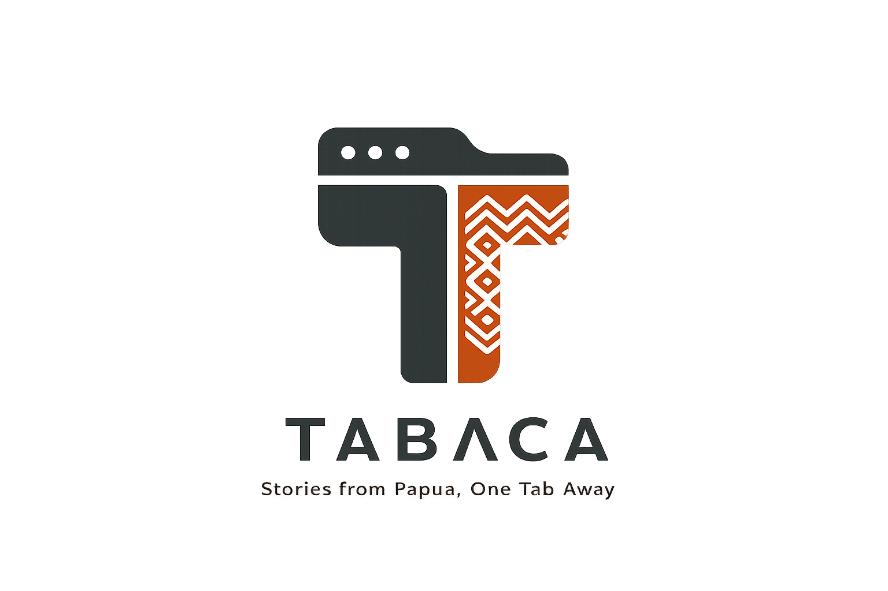

<p align="center">
  
</p>

<p align="center">
  <strong>Stories from Papua, One Tab Away</strong>
</p>

<p align="center">
  Tabaca is an open-source browser extension that turns every new tab into a calm,
  clean page with essays, opinion, analysis and research about Papua — our picks, not daily news.
</p>

<p align="center">
  An initiative of <a href="https://github.com/papuaopensource">Papua Open Source</a> · MIT License
</p>

---

## Features

- **Writing about Papua on every new tab**: essays, opinion, analysis and research, in a calm card layout inspired by [daily.dev](https://daily.dev). Not daily news. No account, no login.
- **Our picks.** We choose the writers and publications we follow, and add single articles from anywhere when they're worth reading. Every article has a thumbnail.
- **Research, too.** Open-access journal articles, books and reports about Papua (via [OpenAlex](https://openalex.org)), including work from Indonesian campuses (UNCEN, UNIPA, Musamus, UI, UGM, …) in the social sciences, business, technology, environment and health, appear with a clean cover showing the journal or publisher, the abstract as summary, and a link to the full text.
- **For you** is different on every new tab: recent and not-yet-seen pieces come first, but older essays keep showing up too. **Shuffle** gives you another set. **Latest** lists the newest first. Tabs filter by type (**All · Articles · Research**), and scrolling loads more.
- **Click a card for a short summary.** Use **Read full story** to open the article on its original site in a new tab. ⌘/Ctrl-click a card to go there directly.
- **Quick search** (`⌘K`, `Ctrl K` or `/`) through the stories, or straight to the web with your browser's default search engine.
- **Copy and share** a story's link, then share it to WhatsApp, X, Facebook or Telegram.
- **Read stats**: an anonymous count of how often a story was read through Tabaca. There are no upvotes and no comments.
- **Only Papua, only safe.** A story shows up only if it is about Papua, links to the site that published it, and doesn't match the blocklist (gambling spam, adult content, explicit graphic-content warnings).
- **Admins curate in the backend admin panel**: add feeds (e.g. an outlet's opinion section or a Papua topic), or paste the URL of a single article. Title, summary and thumbnail are filled in automatically.
- **Dark, neutral and quiet.** The interface is in English; stories stay in the language they were published in, which is mostly Indonesian.

Tabaca shows only the headline, a short summary, and a link to the original article. No article content is re-hosted.

## How it works

```
Feeds we follow (RSS, Atom, WordPress API, OpenAlex) + single articles picked by hand
        │  fetch_stories (every 30 min)
        ▼
Django backend ── keeps pieces that are about Papua and safe (articles need a thumbnail)
        │  /api/v1/stories/
        ▼
Browser extension ── caches the collection and picks a new selection for each new tab
```

## Repository

This is a monorepo managed with [Turborepo](https://turborepo.com) and [pnpm workspaces](https://pnpm.io/workspaces):

| Path                     | What it is                                              |
| ------------------------ | ------------------------------------------------------- |
| `apps/extension`         | The browser extension (WXT, React, Tailwind CSS)        |
| `apps/backend`           | The API and admin panel (Django, Django REST Framework) |
| `packages/api`           | Typed API client shared by the frontend apps            |
| `packages/eslint-config` | Shared ESLint configuration                             |

## Getting started

See [DEVELOPMENT.md](DEVELOPMENT.md) for local setup, the architecture, the API reference, and how curation and safety work.

## Contributing

Contributions are welcome. Read [CONTRIBUTING.md](CONTRIBUTING.md) first. Proposals for new sources go through a _source proposal_ issue.

## License

[MIT](LICENSE) © Papua Open Source
